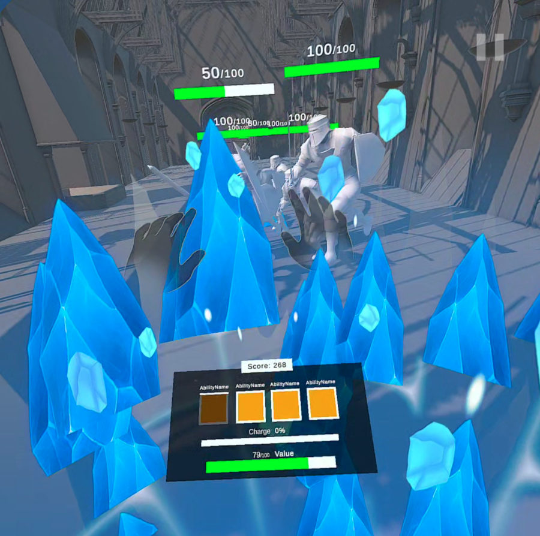
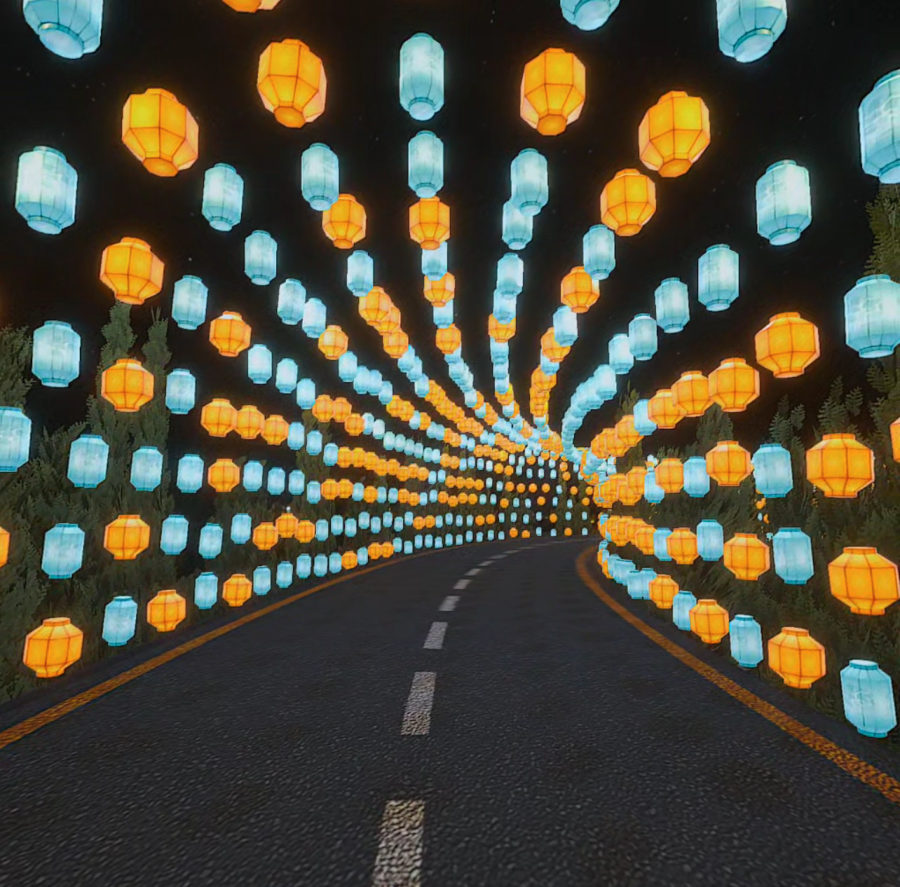
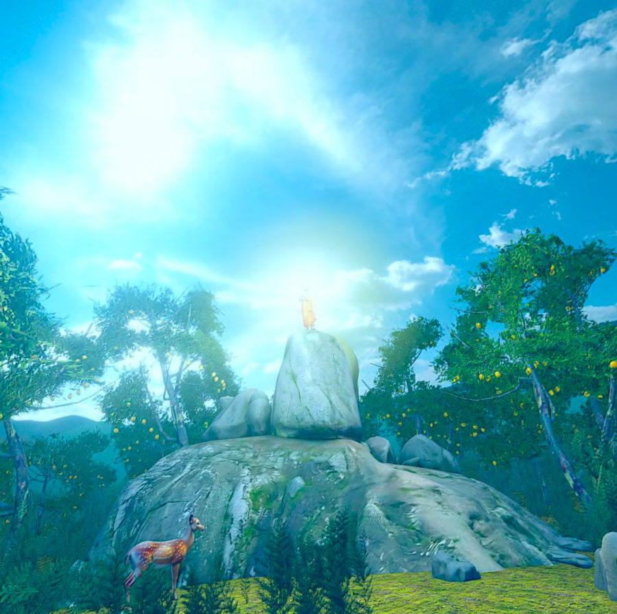

# Hi, I'm Mohamed Asan

**XR game developer and software engineer** in Colombo, Sri Lanka. I build VR and mixed-reality games in **Unity (C#)** and **Unreal Engine 5 (C++, Blueprints)** for Meta Quest and PCVR, and ship web and Android products with **React, TypeScript, Kotlin and Firebase**. I'm the founder of **[IBN](https://www.ibnxr.com)**, an XR and software studio.

> At **Techno 2026** (BMICH), my VR and MR builds **ArcPilot** and **Codexis MR Labs** drew **300+ players in three days**, more than 110 a day.

## From my games

<table>
  <tr>
    <td width="50%"> <b>ArcPilot / Travel with Ravana VR</b>: Quest 3 flight steered with a real wooden wheel. Unity 6. (Still enhanced from a Unity screenshot.)</td>
    <td width="50%"> <b>Avatar: Master of the Elements</b>: hand-tracking magic battle, with spells cast by gesture. Unity 6, prototype.</td>
  </tr>
  <tr>
    <td width="50%"> <b>VR Lantern Arch</b>: a Vesak night with a lantern tunnel and a pandal, made for the SLIIT Vesak VR Zone. Unity 6.</td>
    <td width="50%"> <b>Mihintale VR</b>: the Mihintale legend in VR, made for the SLIIT Vesak VR Zone. Unity 6.</td>
  </tr>
</table>

## Featured work

| Project | What it is | Built with |
|---|---|---|
| [ArcPilot](https://www.ibnxr.com/work/arcpilot/) | 5-minute VR flight over Sri Lanka, steered by controllers in a real wheel; 3 networked stalls run from a web portal | Unity 6 · URP · Meta XR SDK · Quest 3 |
| [Codexis MR Labs](https://www.ibnxr.com/work/codexis-mr-labs/) | Mixed-reality STEM storytelling with hand tracking, an IoT wristband and a live teacher dashboard (SLIIT research, team lead) | Unity · Meta XR SDK · Quest 3 passthrough |
| [VR Kotta Pora](https://www.ibnxr.com/work/vr-kotta-pora/) | Two-player VR pillow fight: 73+ players, 25% more store visits | Unreal Engine 5 · Quest 3S |
| [IBN Street VR Valentine's](https://www.ibnxr.com/work/ibn-street-vr-valentines/) | Street VR game built in 4 days: 45+ walk-up players, 85K+ teaser views | Unreal Engine 5 · Quest 3S |
| [The Dementor's Gauntlet](https://www.ibnxr.com/work/harry-potter-pcvr-spellcasting/) | PCVR spellcasting game with Lumen lighting and a live scoreboard | Unreal Engine 5 · Lumen · Blender |
| SLIIT Vesak VR Zone | Mihintale VR and VR Lantern Arch, two complete Quest experiences | Unity 6 · Meta XR SDK · OpenXR |
| Avatar: Master of the Elements | Hand-tracking magic battle: gesture detection from recorded hand poses, elemental projectiles | Unity 6 · Meta XR Interaction SDK |
| [MindSpring](https://www.ibnxr.com/work/mindspring/) · [code](https://github.com/InfinityBrainNetworks/MindSpring-SE4041) | Personal-growth app: native Android + web, offline-first, 1–2 s sync | Kotlin · Jetpack Compose · React · Firebase |
| [LegalDocs](https://www.ibnxr.com/work/legaldocs/) | Form-to-Word legal document builder with 1:1 Word fidelity | React · TypeScript · Firebase |
| [Day Book](https://www.ibnxr.com/work/daybook/) | Mobile-first cash book PWA for small shops | React 19 · TypeScript · Firebase |

Most studio and client code is private. The case studies on **[ibnxr.com/work](https://www.ibnxr.com/work/)** show each project in action.

## Tech

**Engines:** Unity 6, Unreal Engine 5 · **Languages:** C#, C++, TypeScript, JavaScript, Kotlin · **XR:** Meta Quest, Meta XR SDK, OpenXR, hand tracking, passthrough MR, PCVR · **Web & mobile:** React, Jetpack Compose, Astro, Next.js, Firebase, Vercel · **3D & design:** Blender, Figma, Adobe CC

## Contact

[LinkedIn](https://www.linkedin.com/in/mohamed-asan-083475214/) · [Portfolio](https://www.ibnxr.com/work/) · [Behance](https://www.behance.net/mohamedhasan89) · Open to remote roles
